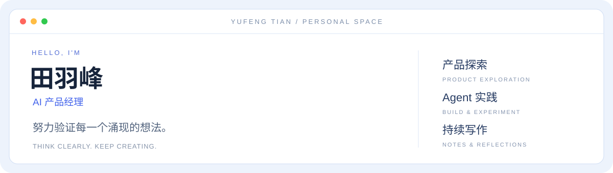

  <a href="https://buu206.github.io/">个人网站 ↗</a> ·
  <a href="#项目">项目</a> ·
  <a href="#技能与关注方向">技能与标签</a> ·
  <a href="#文章">文章</a> ·
  <a href="https://buu206.github.io/#contact">保持联系 ↗</a>

### 你好，我是田羽峰

一名 AI 产品经理。我关心产品解决了谁的问题，也关心使用者能否理解它、信任它，并掌握自己的选择。

这里记录我的公开项目、Agent 实践和文章。从一个具体场景出发，把想法做成可以体验的东西，再从反馈中继续调整。

## 技能与关注方向

`AI 产品经理` `Agent Skills` `系统提示词` `产品评测` `交互体验` `景观可视化` `持续写作`

| 方向 | 实践内容 |
| :--- | :--- |
| **AI 产品与评测** | 场景与需求分析、PRD 与系统提示词、生成式 AI 体验及评测复盘。 |
| **Agent 与提示词** | 编写景观手绘 Skill，按图纸类型组织工作流，输出提示词、可调参数与检查清单。 |
| **原型与交互** | 使用 HTML、CSS、JavaScript 制作网页；在体育社区课堂项目中实践 GSAP 滚动叙事与页内交互。 |
| **工具与发布** | Codex、Pi Agent、GitHub CLI 与 GitHub Pages；公开记录项目和个人网站的迭代。 |

## 项目

### 01 / 皿星 MINXING · AI 微生物培养探索

面向学生的虚拟微生物培养产品原型。选择菌种与培养条件，在 3D 展台和数据监控之间观察变化、记录发现，也可以探索图鉴和菌落画室。AI 伙伴「萤萤」已接入 Qwen，结合当前培养记录回答问题；培养过程为教学模拟。

`AI 产品` `Three.js` `Qwen` `Cloudflare Workers`

[在线体验 ↗](https://buu206.github.io/minxing/) · [项目源码 ↗](https://github.com/buu206/minxing)

### 02 / Landscape Sketch · 景观手绘 Skill

将景观设计想法整理为图像模型可用的英文提示词，附中文说明、可调参数与图纸检查清单。覆盖彩平、透视、剖立面、分析图及四季氛围，提供儿童游乐园日夜景示例。

`Agent Skill` `Prompt Design` `景观概念表达`

[项目源码 ↗](https://github.com/buu206/landscape-sketch-skill) · [体验展示页 ↗](https://buu206.github.io/landscape-sketch-skill/)

### 03 / HUPU — HOME COURT

虎扑体育社区单页课堂作品：用滚动叙事、照片档案、球衣收藏墙和球员评分交互，探索体育社区的视觉与操作体验。内容为课堂演示数据。

`JavaScript` `GSAP` `ScrollTrigger` `交互原型`

[项目源码 ↗](https://github.com/buu206/hupu-home-court) · [体验演示 ↗](https://buu206.github.io/hupu-home-court/)

### 04 / 个人网站 · 田羽峰的个人 OS

浅蓝桌面与窗口式布局，集合个人介绍、产品探索、工具索引、文章和联系入口。支持手机与电脑、快捷搜索，以及通过 GitHub Pages 持续发布。

`HTML / CSS / JavaScript` `GitHub Pages` `Build in Public`

[打开个人网站 ↗](https://buu206.github.io/) · [网站源码 ↗](https://github.com/buu206/buu206.github.io)

### 全部公开仓库

| 仓库 | 内容 | 入口 |
| :--- | :--- | :--- |
| [minxing](https://github.com/buu206/minxing) | 皿星：虚拟微生物培养、3D 观察与 AI 伙伴萤萤。 | [在线体验](https://buu206.github.io/minxing/) |
| [landscape-sketch-skill](https://github.com/buu206/landscape-sketch-skill) | 景观手绘与效果图提示词 Skill、工作流和日夜景示例。 | [展示页](https://buu206.github.io/landscape-sketch-skill/) |
| [hupu-home-court](https://github.com/buu206/hupu-home-court) | 体育社区单页课堂项目，滚动叙事与交互原型。 | [演示](https://buu206.github.io/hupu-home-court/) |
| [buu206.github.io](https://github.com/buu206/buu206.github.io) | 个人网站：产品探索、工具实践与思考随笔。 | [个人网站](https://buu206.github.io/) |
| [buu206](https://github.com/buu206/buu206) | 当前 GitHub 个人主页的介绍与内容索引。 | [GitHub 主页](https://github.com/buu206) |

[浏览全部仓库 ↗](https://github.com/buu206?tab=repositories)

## 文章

把实践中的问题和判断写下来。以下文章均可直接打开公众号原文。

| 文章 | 主题 |
| :--- | :--- |
| [AI产品经理最该补的一课：评测-生图Agent踩坑记](https://mp.weixin.qq.com/s/FZ6ikyZfcFKVSd_QdACczA) | AI 产品 · 评测复盘 |
| [我不想当AI的狗，但我已经离不开它了](https://mp.weixin.qq.com/s/9V9A3rPhE8edlX4A97FhrQ) | AI 与人的关系 |
| [系统提示词，其实就是写给AI的PRD](https://mp.weixin.qq.com/s/QqcKhCSQw93n_OK1ipQWBA) | 系统提示词 · 产品思考 |

[在个人网站浏览文章 ↗](https://buu206.github.io/#notes)

## 保持联系

**下一个想法，从一次交流开始。**

关于 AI、产品，或一个值得琢磨的问题，欢迎交流。

- [打开我的个人网站 ↗](https://buu206.github.io/)
- [进入「保持联系」页面 ↗](https://buu206.github.io/#contact)
- [邮件联系：190782129@qq.com](mailto:190782129@qq.com)

---

记录思考，保持好奇。 Stay curious. Keep making.

